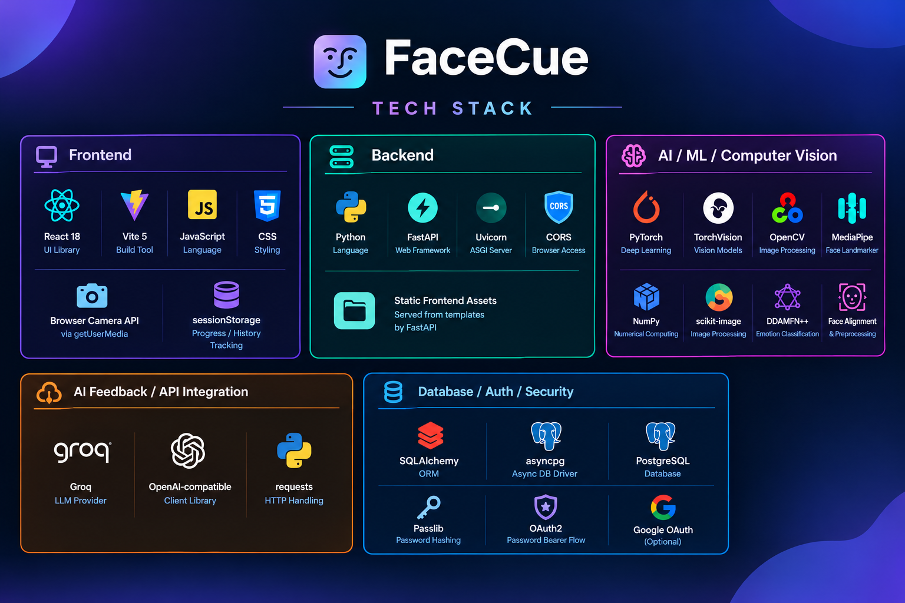

# FaceCue

Practice the expression. Feel the difference.

FaceCue makes facial-expression practice more accessible for individuals with ADHD through a free, AI-powered learning experience designed around independent practice, without the pressure of real-time social interaction.

<p align="center">
  
</p>

## Overview

FaceCue is an AI-powered facial-expression training app designed primarily for individuals with ADHD who want to practice expressing emotions in a comfortable, self-paced environment. By combining facial landmark detection, emotion recognition, and personalized AI coaching, FaceCue helps users compare their expressions with a target emotion, understand the differences, and practice improving through repeated attempts. The focus is on learning and confidence, not diagnosis.

## Why FaceCue?

For individuals who experience challenges with non-verbal communication, practicing facial expressions can be difficult without accessible guidance and opportunities for repetition. Most emotion recognition tools simply identify an expression without explaining how to adjust it. FaceCue bridges this gap by combining emotion analysis with actionable, personalized feedback, helping users understand which aspects of their expression align with the target and what they can practice next — all in a pressure-free learning environment.

## Key Features

- 7 target emotions: Happy, Sad, Angry, Fear, Surprise, Neutral, and Disgust
- Image upload or live camera capture
- Face detection and landmark-based alignment
- Emotion prediction with probability breakdowns
- Personalized coaching feedback based on the selected target emotion
- Session-based progress tracking for repeated attempts
- Responsive UI with motion-aware interactions

## How It Works

1. Select the emotion you want to practice.
2. View a quick expression guide if helpful.
3. Upload a photo or capture one with the camera.
4. FaceCue analyzes the image and predicts the most likely emotion.
5. Review the probability distribution and coaching feedback.
6. Try again and compare your session progress over time.

## Tech Stack

<p align="center">
  
</p>

<div align="center">

<table width="760">
  <thead>
    <tr>
      <th width="380">Frontend</th>
      <th width="380">Backend</th>
    </tr>
  </thead>
  <tbody>
    <tr><td align="left">React</td><td align="left">Python</td></tr>
    <tr><td align="left">Vite</td><td align="left">FastAPI</td></tr>
    <tr><td align="left">JavaScript</td><td align="left">Uvicorn</td></tr>
    <tr><td align="left">CSS</td><td align="left">SQLAlchemy</td></tr>
    <tr><td align="left">Browser Camera API</td><td align="left">PostgreSQL-compatible async database support</td></tr>
    <tr><td align="left">sessionStorage for temporary session tracking</td><td align="left">JWT + bcrypt-based authentication flow</td></tr>
  </tbody>
</table>

<table width="760">
  <thead>
    <tr>
      <th width="380">AI and Vision</th>
      <th width="380">AI Feedback</th>
    </tr>
  </thead>
  <tbody>
    <tr><td align="left">PyTorch</td><td align="left">Groq API</td></tr>
    <tr><td align="left">TorchVision</td><td align="left">OpenAI-compatible client patterns</td></tr>
    <tr><td align="left">OpenCV</td><td align="left">HTTP-based integration for coaching responses</td></tr>
    <tr><td align="left">MediaPipe Face Landmarker</td><td align="left"></td></tr>
    <tr><td align="left">scikit-image</td><td align="left"></td></tr>
    <tr><td align="left">NumPy</td><td align="left"></td></tr>
    <tr><td align="left">DDAMFN++ emotion classification model</td><td align="left"></td></tr>
  </tbody>
</table>

</div>

## Quick Start

### Prerequisites

- Python 3.10+
- Node.js and npm
- A Groq API key
- Optional: PostgreSQL connection URL for backend auth/database features

### 1) Clone the repo

```bash
git clone https://github.com/Wertegved/FaceCue.git
cd FaceCue
```

### 2) Set up environment variables

Create a local `.env` file from the example:

```bash
cp .env.example .env
```

### 3) Install backend dependencies

```bash
python -m venv .venv
source .venv/bin/activate  # Windows: .\.venv\Scripts\Activate.ps1
python -m pip install -r requirements.txt
```

### 4) Install frontend dependencies

```bash
npm install
```

### 5) Run the app

Start the API:

```bash
uvicorn wsgi:app --reload --host 127.0.0.1 --port 8000
```

## API Overview

The backend exposes endpoints for:

- `POST /post/image` – upload an image and receive emotion predictions
- `POST /response` – send analysis output and target emotion for coaching feedback
- `GET /health` – health check endpoint

## Notes

- Camera access requires a secure context such as localhost or HTTPS.
- Prediction quality depends on lighting, face visibility, and image clarity.
- Results should be treated as educational guidance rather than definitive judgments about a person's internal state.

## License

This project is licensed under the [MIT License](./LICENSE).